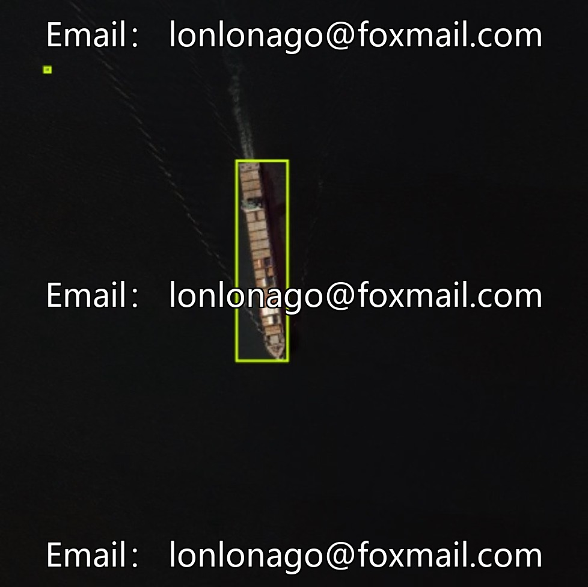
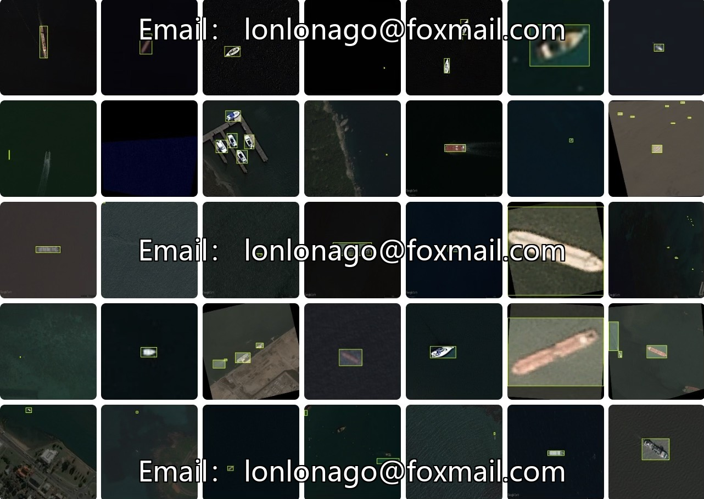
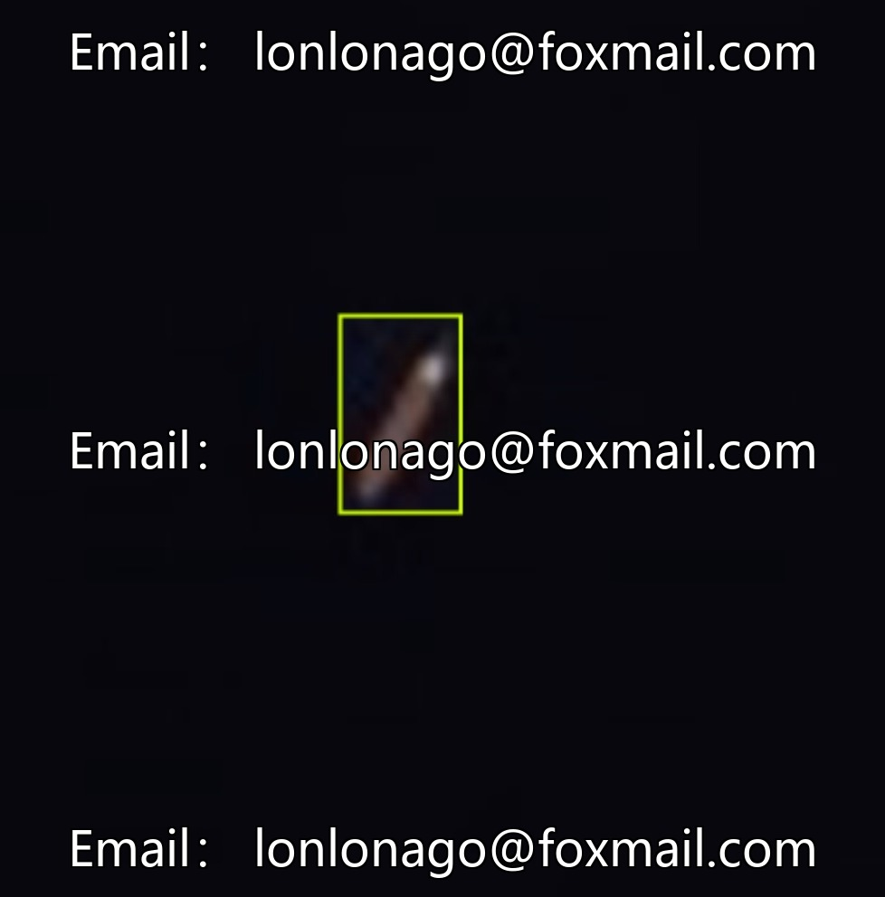
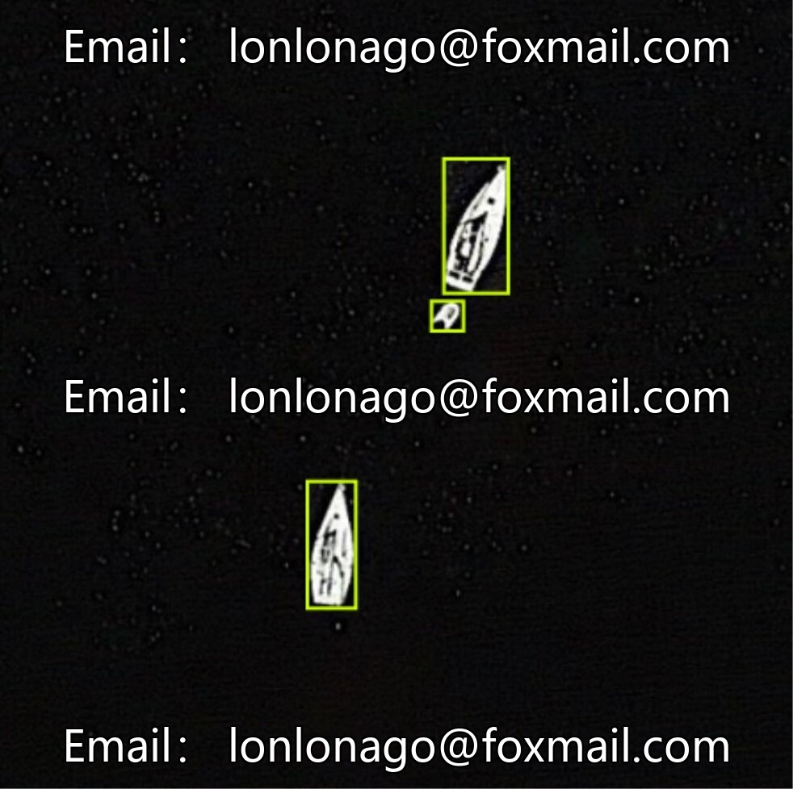

# Drone Smart Remote Sensing Image Ship Image Recognition Dataset, including 9252 remote sensing ship images.

## Body

Drone Smart Remote Sensing Image Ship Image Recognition Dataset, comprising 9252 remote sensing ship images categorized as "ship" (boat), in formats of VOC and COCO, suitable for training and validation of target detection models. The dataset focuses on ship target detection, supports research related to remote sensing seminars, and can be applied in scenarios such as maritime monitoring and shipping management.

The data volume is sufficient, with clear annotation support. The whole process of model training and performance verification is covered, avoiding the issue of poor generalization ability caused by insufficient sample size, providing data guarantee for improving the accuracy of the model.

Virtual materials, once sold, are non-refundable.
Interested friends, click "I want" to proceed.

## Images

## Payment

Here is a pay link on Stripe ( https://buy.stripe.com/3cs8yP7sY87d0vu9AB ). Please contact me lonlonago@foxmail.com after funding $89, and I will send you a complete data files , thank you!

